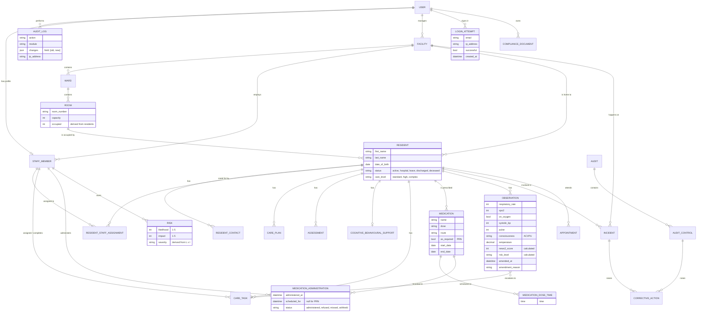
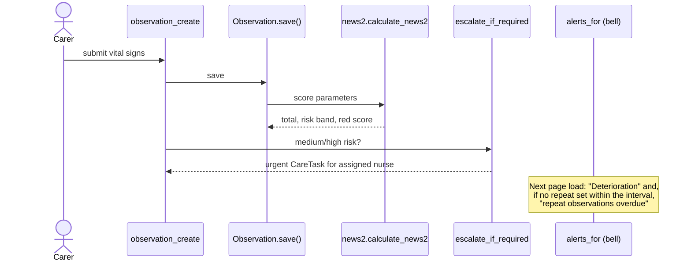

# CareCore architecture

This document describes CareCore's data model, module boundaries and the main
design decisions. The diagrams are written in [Mermaid](https://mermaid.js.org/)
and render directly on GitHub.

## Entity–relationship diagram

## Modules

| App | Responsibility |
| --- | --- |
| `accounts` | Users, roles → permission groups, email login, sign-in throttling, approval of new accounts, password reset, audit trail, facility scoping |
| `facility` | Facilities, wards, rooms; derived occupancy |
| `residents` | Residents and contacts |
| `staff` | Staff profiles, resident assignments, personal workspace |
| `care` | Care plans, assessments, behavioural support, care tasks |
| `medications` | Prescriptions, dose schedules, medication round, MAR |
| `observations` | Vital signs, NEWS2 scoring, escalation, amendments |
| `incidents` | Incident reporting and investigation |
| `appointments` | Resident appointments |
| `compliance` | Risk register, policies, audits, corrective actions |
| `insights` | Alert engine, resident risk score, analytics, handover, CSV export |

## Key flows

### Deterioration → escalation

### Medication round

1. Each `Medication` has zero or more `MedicationDoseTime`s (none for PRN).
2. `medications.schedule.scheduled_doses()` expands them into dated doses and
   matches each to the `MedicationAdministration` whose `scheduled_for` equals it.
3. An unmatched dose is *upcoming*, *due* (±60 minutes) or *overdue*.
4. The round page, the 7-day MAR grid and the "Dose overdue" alert all use the
   same function, so they always agree.

## Security model

* **Authentication:** email + password; 5 failed attempts per email since its
  last successful sign-in (or 20 per IP) within 15 minutes locks sign-in.
  Attempts are stored in the `LoginAttempt` table, so the limit is shared by
  every server process. New accounts are
  inactive until an administrator approves them and picks the role.
* **Authorisation:** each role maps to a Django permission group
  (`accounts/roles.py`); views check model permissions.
* **Data segregation:** every resident and incident stores its facility (taken
  from the room or resident automatically, chosen explicitly otherwise).
  `accounts/scoping.py` limits every resident-linked query to the facilities
  the user works in or manages; records without a facility are visible to
  administrators only. Lookups outside scope
  return 404 so record existence is not leaked; form dropdowns are filtered so
  submitting another facility's id fails validation.
* **Audit:** create/update/delete on clinical and governance models, sign-ins,
  sign-outs, failed sign-ins, approvals and exports are logged with user, IP and
  field-level changes. The audit log is read-only, including in Django admin.
* **Files:** uploaded policy documents are not publicly served; they are
  streamed by a view that checks the user's permission.
* **Transport/cookies:** with `CARECORE_DEBUG=false`, HTTPS redirect, HSTS and
  secure cookies are on (`manage.py check --deploy` runs in CI).

## Known limitations

* The resident risk score weights are design choices, not a validated clinical
  instrument.
* SQLite suits a single facility server. Multiple application servers would
  need a client–server database.
* Rooms that were already over capacity before the capacity check existed are
  not changed automatically (that needs a decision about who moves). They raise
  a "Room over capacity" alert, are badged on the facility page, and are listed
  by `python manage.py occupancy_report`, which also lists residents without a
  facility.
